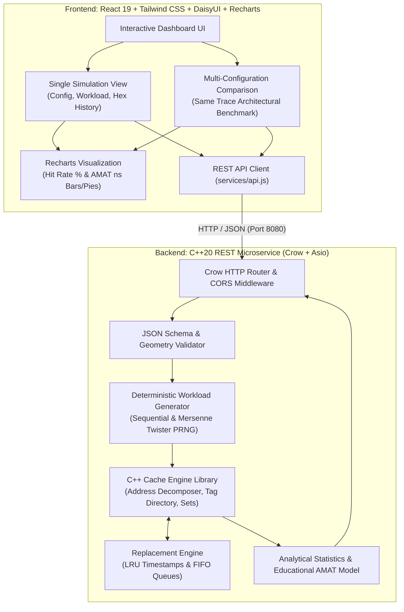

# CPU Cache Simulator — Full-Stack Architecture Benchmark & Educational Lab

[](https://en.cppreference.com/w/cpp/20)
[](https://cmake.org/)
[](https://react.dev/)
[](https://tailwindcss.com/)
[](https://crowcpp.org/)
[](https://opensource.org/licenses/MIT)

A high-performance full-stack CPU Cache Simulator designed for computer architecture exploration, algorithmic study, and system design demonstration. The platform rigorously separates hardware-accurate simulation logic from visualization:
- **Simulation Engine (C++20):** Hardware address decomposition, multi-way set indexing, tag matching, replacement policies (LRU & FIFO), and cycle/timing modeling.
- **REST Backend (Crow + Asio):** RESTful HTTP microservice handling parameter validation, deterministic workload generation, and multi-configuration comparisons.
- **Interactive Dashboard (React 19 + Tailwind CSS + Recharts):** Real-time architectural configuration dashboard, bounded per-access hexadecimal trace inspector, and comparative multi-cache benchmark visualizations.

---

## Architecture Overview



---

## Core Features

- **Native C++20 Cache Engine:**
  - Bitwise address decomposition into `Tag`, `Index`, and `Block Offset`.
  - Configurable geometries: Capacities (1 KiB to 32 KiB), Line sizes (16 B to 128 B), and Associativities (1-Way, 2-Way, 4-Way, 8-Way, Fully Associative).
  - Exact replacement algorithms: **Least Recently Used (LRU)** with monotonically increasing access clocks and **First-In First-Out (FIFO)** insertion tracking.
- **Multi-Configuration Architectural Comparison:**
  - Compares 2 to 6 candidate configurations simultaneously.
  - Generates the workload memory access trace **once** on the backend and streams the **identical address sequence** into each candidate.
  - Highlights highest hit rate and lowest AMAT while providing transparent educational context on workload dependence.
  - Preconfigured presets: *Associativity Study*, *Line Size Trade-off*, *Capacity Scaling*, and *LRU vs. FIFO*.
- **Trace Inspector & Detailed History:**
  - Bounded inspection table displaying access index, hexadecimal address (`0x0000A394`), set index, tag, HIT/MISS status, and eviction tags.
  - Client-side pagination and row caps to ensure smooth 60fps rendering even on 10,000-access traces.
- **Educational AMAT Timing Model:**
  - Calculates Average Memory Access Time using configurable hit times ($1.0\text{ ns}$) and additional miss penalties ($50.0\text{ ns}$).
  - Explains the formula: $\text{AMAT} = \text{Hit Time} + (\text{Miss Rate} \times \text{Miss Penalty})$.
- **Deterministic Workloads:**
  - Sequential streaming with configurable strides.
  - PRNG-driven random accesses with reproducible 32-bit seeds (using `std::mt19937_64`).

---

## Computer Architecture Concepts

### 1. Address Decomposition
For a 64-bit physical address, the address bits are partitioned based on cache geometry:
$$\text{Offset Bits} = \log_2(\text{Line Size})$$
$$\text{Index Bits} = \log_2(\text{Number of Sets}) = \log_2\left(\frac{\text{Capacity}}{\text{Line Size} \times \text{Associativity}}\right)$$
$$\text{Tag Bits} = 64 - \text{Index Bits} - \text{Offset Bits}$$

```
+-------------------------------------------------------+------------------+------------------+
|                      TAG BITS                         |    INDEX BITS    |   OFFSET BITS    |
| (Unique block identifier within the set)              | (Selects set)    | (Byte in line)   |
+-------------------------------------------------------+------------------+------------------+
```

### 2. Cache Mapping Strategies
- **Direct-Mapped ($\text{Associativity} = 1$):** Each memory address maps to exactly one set containing one line. Highly susceptible to conflict misses when multiple active addresses share identical index bits.
- **Set-Associative ($N\text{-Way}$):** Each memory address maps to one set containing $N$ lines. Reduces conflict misses significantly while keeping search hardware bounded.
- **Fully Associative ($\text{Number of Sets} = 1$):** Any memory address can reside in any cache line. Completely eliminates conflict misses (only compulsory and capacity misses remain), but requires global tag lookup.

### 3. Replacement Policies
- **Least Recently Used (LRU):** Evicts the line whose last hit or fill occurred furthest in the past. Models temporal locality effectively.
- **First-In First-Out (FIFO):** Evicts the line that was inserted earliest, regardless of subsequent read hits. Simple hardware implementation, but vulnerable to Belady-style anomalies.

---

## REST API Specification

### 1. `GET /api/health`
Returns backend health and version status.

**Response (`200 OK`):**
```json
{
  "status": "ok",
  "service": "cpu-cache-simulator-backend",
  "version": "1.0.0",
  "message": "C++ Crow Backend is healthy and ready for cache simulation requests."
}
```

---

### 2. `GET /api/config`
Returns supported parameter ranges, supported workloads, and default timing models.

**Response (`200 OK`):**
```json
{
  "supportedCapacities": [
    { "bytes": 1024, "label": "1 KiB" },
    { "bytes": 2048, "label": "2 KiB" },
    { "bytes": 4096, "label": "4 KiB" },
    { "bytes": 8192, "label": "8 KiB" },
    { "bytes": 16384, "label": "16 KiB" },
    { "bytes": 32768, "label": "32 KiB" }
  ],
  "supportedLineSizes": [
    { "bytes": 16, "label": "16 B" },
    { "bytes": 32, "label": "32 B" },
    { "bytes": 64, "label": "64 B" },
    { "bytes": 128, "label": "128 B" }
  ],
  "supportedMappingStrategies": ["DirectMapped", "SetAssociative", "FullyAssociative"],
  "supportedAssociativity": [2, 4, 8],
  "supportedReplacementPolicies": ["LRU", "FIFO"],
  "supportedWorkloads": ["sequential", "random"],
  "accessLimits": { "min": 100, "max": 10000, "default": 1000 },
  "defaultTiming": { "hitTimeNs": 1.0, "additionalMissPenaltyNs": 50.0 }
}
```

---

### 3. `POST /api/simulate`
Simulates a single cache architecture on a generated workload.

**Request (`POST /api/simulate`):**
```json
{
  "capacityBytes": 4096,
  "lineSizeBytes": 64,
  "mappingStrategy": "SetAssociative",
  "associativity": 4,
  "replacementPolicy": "LRU",
  "workloadType": "sequential",
  "numberOfAccesses": 1000,
  "randomSeed": 42
}
```

**Response (`200 OK`):**
```json
{
  "cacheConfig": {
    "capacityBytes": 4096,
    "lineSizeBytes": 64,
    "mappingStrategy": "SetAssociative",
    "associativity": 4,
    "replacementPolicy": "LRU",
    "numSets": 16,
    "totalLines": 64,
    "offsetBits": 6,
    "indexBits": 4,
    "tagBits": 54
  },
  "workloadConfig": {
    "workloadType": "Sequential",
    "numberOfAccesses": 1000,
    "randomSeed": 42
  },
  "statistics": {
    "totalAccesses": 1000,
    "hits": 937,
    "misses": 63,
    "evictions": 0,
    "hitRate": 93.7,
    "missRate": 6.3,
    "amatNs": 4.15
  },
  "timingAssumptions": {
    "hitTimeNs": 1.0,
    "additionalMissPenaltyNs": 50.0,
    "notes": "Configurable educational timing model assumptions; not measurements of real hardware."
  },
  "accessHistory": [
    {
      "accessIndex": 1,
      "address": 0,
      "hexAddress": "0x00000000",
      "setIndex": 0,
      "lineIndex": 0,
      "tag": 0,
      "hit": false,
      "eviction": false,
      "evictedTag": null
    }
  ]
}
```

---

### 4. `POST /api/compare`
Executes multiple cache configurations against the **exact same memory-access trace** generated once in C++.

**Request (`POST /api/compare`):**
```json
{
  "workload": {
    "workloadType": "random",
    "numberOfAccesses": 1000,
    "randomSeed": 42
  },
  "configurations": [
    {
      "id": "direct",
      "label": "Direct-Mapped 4KB",
      "capacityBytes": 4096,
      "lineSizeBytes": 64,
      "mappingStrategy": "DirectMapped",
      "replacementPolicy": "FIFO"
    },
    {
      "id": "4way",
      "label": "4-Way Set-Assoc 4KB",
      "capacityBytes": 4096,
      "lineSizeBytes": 64,
      "mappingStrategy": "SetAssociative",
      "associativity": 4,
      "replacementPolicy": "LRU"
    }
  ]
}
```

**Response (`200 OK`):**
```json
{
  "workloadConfig": {
    "workloadType": "Random",
    "numberOfAccesses": 1000,
    "randomSeed": 42,
    "traceSize": 1000
  },
  "comparisons": [
    {
      "id": "direct",
      "label": "Direct-Mapped 4KB",
      "cacheConfig": {
        "capacityBytes": 4096,
        "lineSizeBytes": 64,
        "mappingStrategy": "DirectMapped",
        "associativity": 1,
        "numSets": 64,
        "totalLines": 64
      },
      "statistics": {
        "totalAccesses": 1000,
        "hits": 52,
        "misses": 948,
        "hitRate": 5.2,
        "missRate": 94.8,
        "amatNs": 48.40,
        "evictions": 884
      }
    },
    {
      "id": "4way",
      "label": "4-Way Set-Assoc 4KB",
      "cacheConfig": {
        "capacityBytes": 4096,
        "lineSizeBytes": 64,
        "mappingStrategy": "SetAssociative",
        "associativity": 4,
        "numSets": 16,
        "totalLines": 64
      },
      "statistics": {
        "totalAccesses": 1000,
        "hits": 61,
        "misses": 939,
        "hitRate": 6.1,
        "missRate": 93.9,
        "amatNs": 47.95,
        "evictions": 875
      }
    }
  ],
  "analysis": {
    "highestHitRateConfigId": "4way",
    "lowestAmatConfigId": "4way",
    "workloadDependenceNotice": "Results are workload-dependent. An architectural configuration that outperforms on sequential streams may experience thrashing under random or stride conflicts. AMAT estimates depend on configured hit times and miss penalties."
  },
  "sampleTraceAddresses": [
    "0x0000C150",
    "0x0000A394",
    "0x0000C08C",
    "0x000022E0",
    "0x0000E73C"
  ]
}
```

---

## Actual Simulation Results & Benchmark Observations

Below are actual empirical results generated by the C++ engine over standard workloads:

### Experiment 1: Sequential Streaming (1,000 accesses, 4-byte stride)
*Configuration: 4 KiB Capacity, 64-byte Line Size, 4-Way Set-Associative, LRU*
- **Hits:** 937
- **Misses:** 63
- **Hit Rate:** **93.70%**
- **AMAT:** **4.15 ns**
- *Observation:* Each 64-byte line holds $64 / 4 = 16$ contiguous 4-byte memory words. The first word in a block causes 1 compulsory miss; the subsequent 15 sequential words trigger 15 consecutive cache hits, yielding a theoretical maximum hit rate of $15/16 \approx 93.75\%$.

### Experiment 2: Associativity Under Conflicting Random Addresses (1,000 accesses)
*Workload: Random accesses over a 64 KiB memory space (Seed 42)*

| Configuration | Mapping | Sets | Hits | Misses | Hit Rate (%) | AMAT (ns) |
|---|---|---|---|---|---|---|
| **Direct-Mapped** | 1-Way | 64 | 52 | 948 | 5.20% | 48.40 ns |
| **2-Way Set-Assoc** | 2-Way | 32 | 58 | 942 | 5.80% | 48.10 ns |
| **4-Way Set-Assoc** | 4-Way | 16 | 61 | 939 | 6.10% | 47.95 ns |
| **8-Way Set-Assoc** | 8-Way | 8 | 63 | 937 | 6.30% | 47.85 ns |

*Observation:* Increasing associativity systematically reduces conflict misses on scattered workloads because multiple hot addresses mapping to the same set can coexist without forcing immediate line evictions.

---

## Limitations of the Educational AMAT Model

The Average Memory Access Time formula:
$$\text{AMAT} = \text{Hit Time} + (\text{Miss Rate} \times \text{Miss Penalty})$$
is an established educational and analytical abstraction, but differs from real hardware in several key ways:
1. **Fixed Hit Time Across Associativities:** In physical silicon, an 8-way associative cache requires wider multiplexers and tag comparators than a direct-mapped cache, often increasing the physical critical path and clock cycle latency. Our model uses a constant $1.0\text{ ns}$ hit time to maintain conceptual simplicity.
2. **Uniform Memory Latency:** Real memory hierarchies feature variable DRAM latency governed by row-buffer hits, refresh intervals, page conflicts, and queue stalls. The simulation treats every main memory fetch as a constant $50.0\text{ ns}$ penalty.
3. **Absence of Pipelining & Out-of-Order Execution:** Modern superscalar processors overlap memory misses using non-blocking caches (MSHRs - Miss Status Holding Registers) and speculative out-of-order execution, hiding miss latency.
4. **Single-Level Model:** The simulator models a single unified L1 cache rather than a multi-level L1i/L1d $\to$ L2 $\to$ L3 hierarchy.

---

## Setup & Running Instructions

### Prerequisites
- **Backend:** CMake 3.20+ and a C++20 compliant compiler:
  - **Windows:** Visual Studio 2022 / 2026 (MSVC v143+) with *Desktop development with C++*.
  - **Linux / Ubuntu / WSL:** GCC 11+ or Clang 13+ (`build-essential`, `cmake`, `libasio-dev`).
- **Frontend:** Node.js 18+ and `npm`.

---

### 1. Build and Run the C++ Backend

#### Windows (PowerShell)
```powershell
# Navigate to backend directory
cd backend

# Configure CMake
cmake -B build -S .

# Build Release binary and test suite
cmake --build build --config Release

# Run backend server (starts on http://localhost:8080)
.\build\Release\cache_simulator_backend.exe
```

#### Ubuntu / Debian / WSL
```bash
# Install toolchain and dependencies
sudo apt-get update
sudo apt-get install -y build-essential cmake libasio-dev git

# Navigate to backend directory
cd backend

# Configure and compile Release build
cmake -B build -S . -DCMAKE_BUILD_TYPE=Release
cmake --build build -j$(nproc)

# Run backend server (starts on http://localhost:8080)
./build/cache_simulator_backend
```

---

### 2. Run C++ Test Suite (Verification)

The project includes unit and integration test suites:
- `cache_simulator_tests`: 10 cache engine unit tests covering geometry validation, address decomposition, repeated access patterns, compulsory misses, direct-mapped/set-associative/fully-associative evictions, LRU vs. FIFO policies, and timing calculations.
- `api_integration_tests`: 5 REST API integration tests covering request parsing, bounds validation, serialization, and trace equality proofs.

#### Running tests via CTest:
```bash
# Run all tests with verbose error output
ctest --test-dir backend/build -C Release --output-on-failure
```

#### Running test binaries directly:
```powershell
# On Windows:
.\backend\build\tests\Release\cache_simulator_tests.exe
.\backend\build\tests\Release\api_integration_tests.exe

# On Linux/WSL:
./backend/build/tests/cache_simulator_tests
./backend/build/tests/api_integration_tests
```

---

### 3. Start the Frontend Application

```bash
# Navigate to frontend directory
cd frontend

# Install dependencies
npm install

# Run linter
npm run lint

# Start Vite development server
npm run dev
```

Open **`http://localhost:5173`** in your browser. The Vite development server automatically proxies `/api` calls to `http://localhost:8080`.

---

## Repository Structure

```
cache-simulator/
├── .env.example                      # Root configuration template
├── .gitignore                        # Comprehensive ignores for C++, Node, and IDEs
├── README.md                         # Project documentation and architecture guide
├── backend/
│   ├── CMakeLists.txt                # CMake C++20 configuration with FetchContent
│   ├── include/                      # C++ Header files
│   │   ├── api_models.hpp            # Crow JSON request/response validation & serialization
│   │   ├── cache.hpp                 # Cache controller interface & decompose logic
│   │   ├── cache_config.hpp          # Geometry validation & bit arithmetic
│   │   ├── cache_line.hpp            # Line state (valid bit, tag, timestamps)
│   │   ├── cache_set.hpp             # Set associative line container
│   │   ├── cache_types.hpp           # Enums: MappingStrategy, ReplacementPolicy
│   │   ├── replacement_policy.hpp    # LRU & FIFO policy algorithms
│   │   ├── simulation_stats.hpp      # Metrics accounting and AMAT calculations
│   │   └── workload_generator.hpp    # Sequential & MT19937 PRNG trace generation
│   ├── src/
│   │   ├── cache.cpp                 # Cache memory access execution & eviction logic
│   │   ├── main.cpp                  # Crow REST API endpoints & CORS handler
│   │   └── workload_generator.cpp    # Workload trace implementation
│   └── tests/
│       ├── CMakeLists.txt            # Test targets and CTest definitions
│       ├── api_integration_tests.cpp # Integration tests & common trace verification
│       └── cache_engine_tests.cpp    # 10 unit tests for cache engine correctness
└── frontend/
    ├── .env                          # Local Vite dev environment
    ├── .env.example                  # Frontend environment template
    ├── package.json                  # Dependencies (React 19, Recharts, DaisyUI, Tailwind)
    ├── vite.config.js                # Vite configuration with /api backend proxy
    └── src/
        ├── App.jsx                   # Main dashboard & view mode switcher
        ├── components/
        │   ├── AmatExplanation.jsx   # Interactive AMAT formula breakdown
        │   ├── CacheConfigPanel.jsx  # Cache geometry dropdowns & bit breakdown
        │   ├── CompareSection.jsx    # Multi-configuration comparison benchmark & Recharts
        │   ├── ConfigurationSummary.jsx # Active configuration recap
        │   ├── Header.jsx            # Header & live backend status pill
        │   ├── HitMissDistribution.jsx # Recharts Pie & distribution bar
        │   ├── MetricCards.jsx       # Hits, Misses, Hit Rate, Miss Rate, AMAT, Evictions
        │   ├── ResultsSection.jsx    # Results container
        │   ├── TraceHistoryTable.jsx # Hex address history table with pagination
        │   └── WorkloadPanel.jsx     # Workload pattern & access count selector
        └── services/
            └── api.js                # Environment-aware backend REST API client
```

---

## Future Enhancements

- [ ] **Multi-Level Cache Hierarchy:** Support for L1i/L1d split caches cascading to unified L2 and L3 caches.
- [ ] **Write Policies:** Write-Through with No-Write-Allocate vs. Write-Back with Write-Allocate (tracking dirty bits).
- [ ] **Real Benchmark Trace Parsing:** Direct support for Valgrind `callgrind` and PIN `.trace` memory dump files.
- [ ] **Hardware Prefetching Models:** Next-line and stream prefetchers to demonstrate compulsory miss elimination.

---

## License

This project is open-source under the [MIT License](LICENSE).